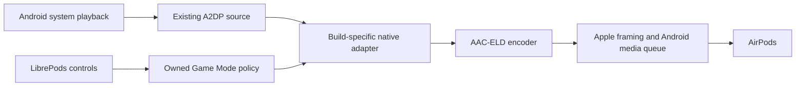

# AAC-ELD through the LibrePods Xposed module

## Current result

The Note8 adapter remains build-pinned. The SDK37 Pixel prototype now has its
own exact-symbol resolver, native codec registration, extended Java identity,
wire helpers and software-PCM encoder adapter. Neither is enabled by default.
Ordinary codecs and Apple identity remain independent. Unknown layouts or
conflicting codec registrations are rejected. The Pixel's private preview now
plays audible AAC-ELD through Android's software Bluetooth route. Corrected host
flush handling keeps ELD selected through clean pause/resume, and the guarded
registry-restoration repair has passed a live full case return.

Primary-bud docking caused silence in the baseline preview while valid audio
continued. The private bounded-pacing preview has now passed that targeted
right-to-left handover, followed by docking/reinsertion on both sides with tracing
detached. Source diagnostics distinguish retained queue-backpressure debt from a
source-callback stall in this passing trial. The final full-case return was
automatic, playback and two pause/resume cycles were clean and smooth, and the
listening-mode stem control worked, all with tracing off. These results do not
establish the complete failure mechanism, long-term reliability or acoustic
latency. Game Mode has its own evidence and acceptance boundary below.

The same guarded SDK37 adapter subsequently passed ordinary ELD music,
pause/resume, one-bud, stem and automatic case-return checks on the Pixel 10
Pro XL. A captured private On/Off Game Mode cycle then verified real controller
read/write/readback, fresh receiver reports and both owned finite clock
completions while music remained clean. See [the frame references and limits](GAME-MODE.md#pixel-10-coordinated-onoff-trial).
That captured APK reported a stale held-state validation as StaleOwner after
successful graceful cleanup. The mutex-guarded status fix passed42 HCI/runtime
and13 encoder sanitizer checks. Its follow-up `de3ac2de…` APK was installed and
ordinary audio confirmed, but the user stopped before a final On/Off check.
Calls/SCO, Game Mode case returns, long-run stability and Pixel 7's full cycle
remain pending. No acoustic latency claim follows from these results.

The later Headphone Accommodations comparison remained negative despite working
48 kHz / 256 kbps ELD: neither master Off/On nor Audiogram versus Brightness /
Strong produced a reported audible difference. Original hearing/tuning records
were restored exactly, and ordinary music, pause/resume and stem controls passed
after cleanup. ELD playback does not establish accommodations processing; see
the [controlled comparison](#pixel-headphone-accommodations-check).

### Controlled Note8 result and rollback

The October 25 prototype passed startup: exact image/context validation and the
21-hook transaction completed before codec initialization. Bluetooth advertised
the distinct Apple AAC-ELD source at priority 10001. The supplying Android
`AdapterApp` class loader and module receiver are held for the process lifetime;
the validated framework callback handle is used directly, without reopening the
library across Android linker namespaces. Vector v2.2 supplies native API 2.

The fresh capture accepted Apple `004C/8001`, 48 kHz stereo, 256 kbps. Three
incoming SetConfiguration requests were accepted at frame pairs 1161/1162,
1570/1571 and 1932/1933. Open and media L2CAP setup also completed. The retained
capture has SHA-256
`2a2506c762fb77090cf7a6e3b0db1c933c8f1dfaa067eb35c1bc40aaf85b4ef1`.
It contains no AVDTP Start or media RTP packets, so it does not prove playback.

Profile activation then blocked. A thread snapshot shows the active-device
caller waiting on a native future, while codec callbacks and profile status
requests wait on the A2DP service monitor. The source worker was sampled in
stock SBC initialization. This does not establish an ELD encoder-mutex deadlock;
the cause remains unresolved. Remote disconnects and renewed negotiation followed.

At the user's request, Note8 testing stopped pending a rooted Pixel 7 Pro on
Android 17. The startup opt-in was synchronously disabled and checked from a
fresh process, the original Note8 app was restored, and Bluetooth restarted.
Its status dump completed normally and no longer advertised ELD. Temporary
probe/control packages were removed and the paused Windows reconnect request
was restored. Source and private evidence were retained. Android 17 requires
its own verified adapter; these Note8 offsets and HIDL assumptions do not apply.

The Note8's exported FDK C API produced the required 480-sample ELD access units
at 128, 192 and 256 kbps. An independent MediaCodec decoder then decoded every
one of the 192 synthetic units into 480 stereo frames. This verifies the encoder
contract, not the A2DP route or acoustic latency. Native Game Mode remains
unavailable until the controller flush-timeout boundary in
[GAME-MODE.md](GAME-MODE.md) is implemented and verified.

### Pixel 7 Pro Android 17 preflight, October 25

The USB-connected Pixel 7 Pro runs `CP3A.261005.002.A1` (SDK 37), with
kernel `6.1.162-android14-11` and KernelSU-Next 3.4.2. Zygisk Next 1.5.2
(864) and stable Vector 2.2 (3080) were installed from checksum-verified
official releases. After one reboot, Vector reported Java API 102 with zero
enabled Xposed modules. Bluetooth was on, its status dump completed with zero
reported crashes, and SELinux remained enforcing. This checks framework
startup without LibrePods injection; it does not establish hook compatibility
or AirPods playback. No LibrePods module was enabled on this phone.

The active Bluetooth image is `/apex/com.android.bt/lib64/libbluetooth_jni.so`,
16,363,216 bytes, SHA-256
`8e30469387d306ec2c9525bd3d09551e7214e6a8d00192f674f884d7a7cc9f5d`,
GNU build ID `18cb1fbc184ab60a6b3f8b3234792924`. Its mini-debug table contains
24,976 entries. The matching Bluetooth APK and framework jar were retained
privately with process maps and hashes.

Static inspection identifies these concrete port requirements:

| Boundary | Pixel evidence and required work |
| --- | --- |
| Apple identity | The native SDP entry is `_Z22BTA_DmSetLocalDiRecordP15t_sdp_di_record`, taking one record argument and returning boolean success. The record's vendor/source/product/version/primary prefix still matches, but the hook's function type and result handling need updating. |
| Java initialization | `A2dpNativeInterface.init` now accepts four arguments. The additional list contains Bluetooth devices, flattened to addresses by `initNative`; supported codec types use a separate enumeration API. The Note8 three-argument hook plan rejects it. |
| Java ownership | Native callbacks are in `A2dpNativeCallback`; the library load is in `AdapterService`, rather than the Note8's `AdapterApp` static initializer. |
| Codec identity | The integer `BluetoothCodecConfig` constructor delegates to `BluetoothCodecType.createFromType`. Unknown values, including the module ID, produce no type and subsequently report the invalid codec value. A new carrier path must preserve the extended identity. |
| Native registry | Construction is inlined in `A2dpCodecs::init`, with indices 0 through 18 and an AIDL provider lookup before built-in fallback. Slot 5 being skipped by that fallback does not prove it is available at runtime. `CodecIndexStr` also returns a platform `std::string`, rather than the Note8 hook's C string. |
| Encoder binding | FDK routines occur in mini-debug symbols but are not dynamic exports. The existing `dlsym` binder cannot be reused; `aacEncoder_GetParam` and `aacEncGetLibInfo` are absent by exact name in both retained symbol tables. |
| Audio provider | The running service exposes the AIDL Bluetooth audio-provider factory. The Note8's HIDL provider objects and transport assumptions require replacement and real-route verification. |

These are shipped-artifact findings, not observed codec execution. Retain stock
codec handling until the Pixel's identity, registry, Java carrier, encoder and
software-provider contracts have been verified together. The Note8 prototype
and Game Mode remain unavailable on this target.

### Pixel native controls and owned encoder follow-up

The Pixel subsequently loaded the preview with legacy SDP/FCR detours disabled
on SDK 37 and newer. Its native AACP and Classic ATT connections succeeded.
Android's Device ID property path also produced the requested Apple vendor on
wire without a native identity detour. The restored Google-identity control
still read both settings records successfully, so the initial read failure is
not established to be a vendor-only gate. See the complete distinction and
packet references in [Android ATT access](PROTOCOL.md#android-att-access).
Ordinary AAC playback, pause/resume and the listening-mode stem control passed
with capture disabled; this is separate from ELD validation.

An isolated ARM64 encoder statically linked the owned, unmodified S16 FDK
revision `cac04476081a23c870fed05c36228cd02c5e7c3d`, rather than binding Pixel's
internal encoder functions. It emitted 64 AUs at each of 128, 192 and 256 kbps,
with actual ASC `f8e65000`, 480 samples, 48 kHz and stereo input. Maximum AU sizes
were 161, 241 and 320 bytes. Maximum encode calls in this short synthetic run
were approximately 1.225, 0.114 and 0.092 ms respectively; these do not establish
real-time playback deadlines under Bluetooth load.

The captured synthetic stream has SHA-256
`a85e52b2b26a9f99c0cd8d618acf939d57949dafce8184d4fe822af9b636d4cf`.
The Pixel's independent `c2.android.aac.decoder` decoded all 192 units using the
actual file ASC: every nonempty output held exactly 480 stereo frames, at 48 kHz,
with nonzero PCM. The probes opened no audio output or microphone and were
removed after their reports were retained. This owned backend avoids coupling
the encoder to each firmware's private FDK symbols. It is now connected to the
SDK37 prototype described below; this synthetic result alone is not a playback result.

A read-only A2DP proxy inventory returned source indices 7 (LHDCv5), 4 (LDAC),
3 (aptX HD), 2 (aptX), 1 (AAC), 6 (Opus) and 0 (SBC), with unique extended codec
IDs. Index 5 was not registered in that running inventory; this is not a permanent
reservation across updates or provider changes. The inventory required a
temporary instrumentation-only Bluetooth privileged identity and hidden-API
access, both limited to the temporary probe process. No global hidden-API policy
or normal-app permission was changed.

The actual extended Apple codec ID is `0x8001004cffL`; the old module's artificial
integer `0x4c8001` is not a substitute for this carrier. Registering a Java label
alone does not install an encoder, and fabricating AIDL provider support would
select a provider route that does not implement it. Native registry/dispatch,
Java carrier mapping and the software audio-provider path must all pass together.

### Pixel Headphone Accommodations check

With the working SDK37 private ELD path at 48 kHz / 256 kbps, the listener heard
no change from Headphone Accommodations master Off/On or Audiogram versus
Brightness / Strong. The baseline's independent Custom Transparency master was
Off; its scalar fields passed validation. The test finished on the original
Brightness / Strong preset with both Phone and Media On. No new short PME On
Buds command or clinical profile write was introduced.

The first ATT read now follows a complete successful AACP initialization pass,
with input handling and the three-second repeat independent. All 59 focused
tests passed, including five new initial-reader ordering/lifecycle cases. This
removed the observed startup race but did not resolve the subsequent server
AHPS `0x0E`. Temporary supported Device ID properties `76/1` produced fresh Apple
SDP and successful AHPS104/CT104 reads; a following warm Google-DID capture also
read both records. A later uncaptured stock session failed again with `0x0E`.
These results do not establish a vendor-only rule or cold-stock authorization.

Two fresh restoration captures verified every original AHPS104, CT104 and
PME140 byte against the privately saved baseline. The stock capture ended before
the final failed session, so it does not cover that session's settings reads.
All temporary vendor/source properties were restored to their original absence,
no identity module was installed, and capture was off. The user's final normal
music, pause/resume and listening-mode stem check passed on ELD. Capture hashes,
frame references and precise coverage limits are recorded in the
[protocol result](PROTOCOL.md#pixel-7-pro-aac-eld-accommodations-check-2026-10-25);
raw profiles remain private.

Apple's real host `aufx/hear` hearing processor and its separately verified short
PME On Buds control are distinct from encoding PCM as AAC-ELD. The short control's
Boolean `01`/`02` mapping is known, but its activation policy, getter and original
state are not. The positive Windows CT comparison established an ambient effect,
not a PME music-processing gate. Android accommodations processing therefore
remains unresolved; this negative test does not invalidate the ELD playback result.

### SDK37 native integration

The Pixel adapter resolves exact ELF/mini-debug symbols with bounded parsing and
XZ decompression. It checks complete loaded instruction contexts against the
corresponding file and verifies the known object, caller and software-route ABI.
Link-time addresses and ASLR may change; there is no Pixel whole-image hash gate
or fixed-offset fallback. This supports unchanged ABIs across smaller updates,
not a promise that arbitrary Android updates are compatible.

The module borrows the host AAC constructor, allocator, destructor, mutex,
short-string assignment and tree-balancing primitive. No NDK string/container
is passed as a platform libc++ object. The native records are 64 bytes, including
an unknown final eight-byte field; that field is preserved rather than mistaken
for the codec ID. The object's actual 64-bit CodecId has its own field.

Before Android exports supported codecs, a guarded startup cohort stages the
source object, map node and list node for each of the six native registries.
Every member is validated again before the first splice. Allocation failure,
provider support for slot 5, an existing foreign slot, malformed containers or
an unexpected initialization sequence prevent admission. Host-owned objects are
quarantined on later violations; the module does not claim to undo Android's
container ownership. Java publication waits for the complete outer initializer.

The Java initializer also checks both original priority/offload arrays before
the native initializer runs, independently of native readiness. A foreign
extended identity at index 5 vetoes admission; missing or malformed initial
carriers do not count as proof that the index is free.

The native index is 5 only after those collision checks. The public extended ID is
`0x8001004cff`, with explicit startup priority 10001. SDK37 uses a real
`BluetoothCodecType` carrier, preserving all numeric fields and unrelated
codecs. It never substitutes a public LC3 request or fabricates an offload
provider capability. The stock AIDL setup first tests provider support, then
standard codec conversion, then software PCM. The observed slot 5 follows the
last path with 48 kHz, S16, stereo; offload remains available for ordinary codecs.
That native setup alone did not route Android's playback track to the Bluetooth
software audio module; the separate framework mapping failure is recorded below.

The source encoder uses the actual native peer, a bounded PCM accumulator,
480-sample access units and ten encoded silent frames before consuming music.
It preserves RTP/AU continuity across feeding resets. At this earlier adapter
stage, native Game Mode still awaited its separate controller/clock checks;
the later controlled result is recorded in [GAME-MODE.md](GAME-MODE.md).

The owned FDK backend is **private-experiment only**:
`LIBREPODS_PRIVATE_OWNED_FDK=ON` explicitly enables it. Default builds neither
fetch nor link FDK. Its license is not GPL-compatible; a redistributable
integration needs a separately licensed worker/boundary or another compatible
arrangement. Private test artifacts retain both FDK and wrapper notices.

Offline coverage includes 48 Java codec/format tests, Android lint, all four normal APK
ABIs, strict ARM64 private builds, malformed ELF/XZ inputs, exact symbol aliases,
foreign codec forwarding, object teardown, every one of 18 cohort allocation
failures, stale/cancelled initialization and partial-hook rollback. These checks
are distinct from on-device startup, negotiation, PCM delivery and audible audio.
The latest Java run passed all 48 tests; lint reported zero errors and 298
pre-existing warnings.

### SDK37 live negotiation and framework routing gap, October 25

The controlled Pixel run validated all 15 native hooks: 13 wire dispatch hooks
and two initialization/cohort hooks. All six native registry insertions committed,
and Android reported the real Apple extended ID `0x8001004cff` at local source
index 5. In the private `eld-accepted-private.btsnoop`, the Pro 3 pair's incoming
SetConfiguration at frame 258 was accepted at 260; Open at 263 was accepted at
265. The owned encoder subsequently reported initialized, active=true,
failed=false and 256,000 bps. This proves registration, accepted configuration,
opening and encoder initialization; it does not prove PCM delivery or playback.

Three earlier admission/dispatch failures were corrected from concrete evidence:

- Android heap pointers carry a top-byte tag, while `/proc/self/maps` records
  untagged virtual addresses. The mapped-range lookup now normalizes only its
  numeric address comparison. Reads, container pointers and deallocation retain
  the original tagged pointers.
- Byte `+0x227` is initialized by the validated AAC/extension constructors, but
  is not a universal source-role field for foreign codec objects. A stock aptX
  source need not initialize it. Foreign objects are checked against the proven
  native initialization branch and actual map/list membership; this byte remains
  diagnostic evidence rather than an admission requirement.
- `findSourceCodecConfig` inlines the generic dispatcher and directly calls
  `A2DP_VendorSourceCodecIndex`. Hooking only the generic source-index helper
  therefore missed incoming OTA configuration. The added source-only vendor
  hook resolves the exact Apple identity to the admitted index and forwards
  unrelated codecs through its own original trampoline. The remaining encoder,
  RTP, packet-header and equality helpers were checked for the same bypass;
  their observed source callers already reach the hooked generic helpers.

The user then reported completely silent music. Native AIDL had selected
software PCM, but the active Android track remained on the primary hardware
deep-buffer output. Shipped `BtHelper` code passes the full extended codec ID to
`AudioSystem.bluetoothA2dpCodecToAudioFormat(long)`. That mapper does not recognize
the Apple ID: it returns `AUDIO_FORMAT_DEFAULT`, and `BtHelper` falls back to SBC.
The primary hardware profile supports that format, so Android selected the
hardware route rather than the Bluetooth software route.

The inspected native policy code compares the complete encoded format, not just
the AAC family. Apple ELD must map to the existing native
`AUDIO_FORMAT_AAC_ELD` value `0x04000200`; ordinary AAC (`0x04000000`) does not
distinguish the required route. The captured primary hardware profile lacks ELD,
whereas the Bluetooth software module accepts the resulting PCM route.
This is a demonstrated framework routing contract, not evidence that the
phone's hardware encoder supports ELD.

`EldAudioFormatBridge` and its system-server hook now map only the exact full
Apple ID to that native ELD format. Discovery requires SDK37 and the exact
static `(long) -> int` method shape. Every other codec and original result is
preserved. The mapping is independent of the Bluetooth startup opt-in so an
already published Apple identity remains interpretable during disable/recovery.
This hook loads no native codec library, makes no IPC request and acquires no
audio endpoint in system_server. Real SDK37 framework tests cover the original
unknown-ID result, the native ELD format name and unchanged stock/foreign IDs.

The first scope entry used `android`, which does not enable this modern Vector
system-server callback. Vector's source and the actual daemon configuration
confirm the required scope key is `system`. The corrected APK and scope survived
reboot. The hook executed, AudioService reported `AUDIO_FORMAT_AAC_ELD`, and
policy opened the Bluetooth software output with 48 kHz stereo PCM16.

The user reported clean music and working stem controls during the next check.
However, native diagnostics recorded 1,373 accepted ELD packets followed by
quarantine and successful AAC fallback during pause. The exact native queue
callback returns false on its ordinary transmit-flush path, after freeing the
packet and flushing the queue. Treating that return as an encoder failure was
incorrect. The adapter now counts the host discard, advances the encoded AU's
timestamp/sequence and leaves ownership with the host. It retains all actual
encoder, malformed PCM and allocation failure checks. Regression coverage includes
flush races, discarded priming, reset/resume and packet ownership. In the corrected
preview, two pause/resume cycles stayed on ELD: diagnostics retained active=true,
failed=false and poisoned=false while recording four host discards. The user
confirmed clean playback and smooth starts. This is distinct from the first
comparison, which switched to AAC. The native callback's ownership, flag/queue
relations and complete local branch/return contract are now required for admission;
the real image and 42 targeted mutations passed independent checks.

A fresh case return then failed incoming ELD setup with status `0xC2`, despite
the same valid Apple configuration. Native `bta_av_co_audio_close` calls
`BtaAvCoPeer::Init`, which resets/destroys the old registry and constructs a new
one. Its `A2dpCodecs::init` call occurs outside the initial six-registry cohort;
the old hook forwarded that path without restoring ELD. The new registry therefore
contained only stock codecs. Registration must also cover a validated standalone
reinitialization after successful initial publication. The native recursive
registry mutex must span the original initialization and the single-registry
transaction, closing the stock-only window after the original call unlocks.
The repair now performs that guarded count-one transaction after successful
initial publication, with generation/admission checks and lock release on false
returns, exceptions and cancellation. It does not repeat Java capability
publication or retain stale registry ownership. A live full case return now
restored ELD and audible playback; ordinary pause/resume also remained on ELD.
This validates the tested registry lifecycle, not every stream transition.

### Primary-bud handover failure and first pacing result

The 2026-10-25 Pixel 7 Pro / SDK37 comparison distinguished the role of the
docked bud. In the first full capture, the right bud stayed primary while the
left secondary entered its case; playback remained audible. In the subsequent
failure capture, docking the right primary transferred primary role to the left
and left playback silent. Valid access units continued, with independent decoding
showing nonzero stereo audio. There was no coordinated `0x47`–`0x4A` exchange or
AVDTP Suspend/Start during that bounded failure window. The report layouts and
their evidence are in [the protocol reference](PROTOCOL.md#primary-bud-and-coordinated-handover).

An earlier preserved-state manual pause/resume genuinely restored audible ELD
with the same Bluetooth process: the trace observed Suspend, Start and feeding
reset/priming. A later reported recovery fell outside the retained full capture's
watchdog window; that file cannot establish its recovery sequence. Neither result
proves that encoder pacing, a clock mode or a missing acknowledgement caused the
failure. A continued stream, valid decoder output and controller completions
also do not prove that the receiving bud was presenting those samples.

### Private bounded source-pacing experiment

The SDK37 experiment has a private host-adapter opt-in, default off for legacy
hosts including Note8. It retains the 48 kHz counter, 480 samples per AU, one AU
per packet, the queue limit of 12 and 100 ms of paced startup silence. After a
source callback stall it may encode at most four complete AUs per callback,
counting each newly queued AU toward that limit. Queue backpressure preserves
pending scheduling debt without reading more PCM. Underflow, empty encoder
output or an ordinary host discard rebases the schedule and stops the burst;
real encoder/allocation errors retain the existing failure path. Silence primers
remain limited to one per callback and do not consume music PCM.

Per-initialization diagnostics count source callbacks, their maximum gap and
deadline lag, clock rebases, queue deferrals, PCM reads/bytes and extra catch-up
AUs. These measure the source adapter, not HCI queue residence, radio delivery or
receiver presentation. Twelve strict native test suites passed with address and
undefined-behavior sanitizers, including a synthetic 475 ms stall, exact PCM and
timestamp/sequence continuity, bounded catch-up, queue backpressure, partial PCM,
flush and priming.

The first targeted hardware trial passed: a fresh role report selected right
primary before the user docked that bud, then reported left primary while the
left remained audible. The complete capture
`eld-catchup-primary-passed-private.btsnoop` has 10,882 records, no reported
drops, truncation or ACL-reassembly errors, and 5,352 single-AU packets with
continuous RTP sequence and timestamp increments of 480. No Suspend/Start or
reconfiguration intervened. The user subsequently confirmed clean docking and
reinsertion on both sides with tracing detached.

An independent decoder accepted all 5,352 AUs as 480-sample stereo frames at
48 kHz. All 3,624 AUs after the role change contained nonzero audio in both
channels. This checks the outgoing stream, not the receiver's presentation.

The outgoing HCI media gap was 321.354 ms, but the source callback's maximum
gap was only 11.760 ms. Its health snapshot recorded 42 queue deferrals,
160.785 ms maximum scheduling debt, 26 extra catch-up AUs and a maximum burst
of four, with no rebase, encoder failure or quarantine. This trial exercised
retained queue-backpressure debt; the HCI gap was not a source-callback stall.
Afterward, elapsed HCI time minus the 48 kHz RTP content timeline returned to
approximately its 1 ms baseline, whereas the failed baseline capture retained
about 311 ms of deficit. This is a comparison of outgoing timing, not measured
receiver or acoustic latency. The handover stalls differed in duration, so the
comparison does not isolate every firmware/controller condition or prove the
complete cause of the original silence.

The user also confirmed automatic full-case return, two clean pause/resume
cycles and working listening-mode stem control with tracing off. The subsequent
status read remained on 256 kbps ELD with the same Bluetooth process, no encoder
failure or quarantine, and no active packet capture.
The pacing change and owned FDK route remain private opt-ins, with production
defaults off; this is not a general release or a claim that all handovers work.

Broader real-time performance, AAC/SBC recovery, complete stream lifecycle tests
and Game Mode release checks remain pending; the later single Pixel 10 On/Off
result is separate from this pacing trial.
Raw captures, process traces and device identifiers remain private.

## Native hook boundaries

| Boundary | Required change |
| --- | --- |
| Codec factory and registry | Register a distinct Apple AAC-ELD source codec using the verified build's registry and explicit identity mapping. Preserve every implemented source and sink codec. |
| Vendor dispatch | Recognize exact vendor `004C`, codec `8001`; validate capabilities/configuration, select the encoder and supply its codec header/packet interpretation. Forward other vendors unchanged. |
| Source encoder interface | Use the stack's PCM read and packet enqueue callbacks, with bounded queues, correct allocation ownership, reset/flush and a 10 ms frame cadence. Encoding must not block Java or Bluetooth control processing. |
| Media packet construction | Match Apple's AU header, RTP timestamp domain and negotiated MTU exactly. Determine which RTP/header work the stack already performs so it is not duplicated. |
| Offload selection | Admit ELD only through a demonstrated software path. Do not send Apple codec parameters to a DSP that supports only the platform codecs, or disable offload globally for unrelated devices. |
| Java codec status | Expose the distinct codec and its real readiness through Bluetooth codec capabilities/status and selection. Java selection by itself does not add a native implementation. |
| Stream lifecycle | Observe accepted Start, Suspend, Stop, reconfiguration, peer changes, delay reports, SCO and queue teardown for the actual media generation. |

The AOSP source interface already supplies `encoder_init`, `encoder_cleanup`,
`feeding_reset`, `feeding_flush`, `get_encoder_interval_ms`,
`get_effective_frame_size`, `send_frames` and `set_transmit_queue_length`.
Its enqueue callback owns the supplied `BT_HDR` even when enqueue fails; the
adapter must verify the target implementation's contract before deciding what
can be retried. A diagnostic packetizer's failure rules cannot replace that
ownership contract.

## Exact Note8 constraints

The retained LineageOS 20 / Android 13 AArch64 `libbluetooth_jni.so` has SHA-256
`d965f16cba9b9f103d657844eae618ac13b915581da36a4d7720995229e114a7`
and GNU build ID `1bfdd3e2638b93ad5d86f78d3981c5f6`. Its complete mini-debug
symbol table contains 23,187 entries; the original dynamic table contains 9,859.
The private hook inventory records exact
mangled names, sizes, file mappings, initial instructions and whole-body hashes.
An earlier capped symbol producer was insufficient to establish absent symbols.

Candidate ELF virtual addresses for this binary only:

| Candidate | ELF virtual address |
| --- | --- |
| `A2dpCodecConfig::createCodec` | `0x53d554` |
| `A2dpCodecs::init` | `0x53f16c` |
| `A2DP_GetEncoderInterface` | `0x541378` |
| Vendor codec header / encoder dispatch | `0x54b910` / `0x54b96c` |
| Vendor source index / initialization dispatch | `0x54ba5c` / `0x54bb40` |
| Source setup / Start / timer / Stop | `0x4acb4c` / `0x4aaa2c` / `0x4ad840` / `0x4aad74` |

These are not runtime pointers or transferable offsets. The prototype must
validate the exact loaded image and instruction contexts, derive load bias from
the ELF load segments, and resolve each required function unambiguously before
installing any hook. Some small functions share machine code through identical
code folding; hooking the first substring match can intercept unrelated codecs.
Prefer the verified enclosing dispatcher for a codec-conditional interception.

Assembly establishes that this build initializes indices 0 through 10 and
classifies indices at most 6 as sources:

| Index | Existing meaning |
| --- | --- |
| 0–4 | SBC, AAC, aptX, aptX HD, LDAC sources |
| 5 | Reserved/unsupported LC3 source slot |
| 6 | Opus source |
| 7–10 | SBC, AAC, LDAC, Opus sinks |

The smallest first adapter can use internal slot 5 on this exact build:
the factory currently returns no object there, while initialization already
visits it and classifies it as a source. Hooking that factory case avoids
changing the initialization loop, map extent or source/sink boundary. All
implemented slots can remain intact. This is a build-specific candidate, not a
generic unused-slot assumption; reject any build with a real LC3 implementation.

Slot 5 still has LC3 meaning in the framework. Give Apple ELD a distinct module
codec identity and translate it bidirectionally at JNI: current/local/selectable
codec status goes out as ELD, and only the module's ELD preference comes back
as internal 5. Never translate a public LC3 request into ELD. Account for the
framework's codec priority assignment and `switchCodecByBufferSize` paths, plus
codec naming, settings and parcel/capability handling. A name-only override is
not an implementation. These paths must be traced and tested before registration.

On the pinned Note8 APK, priority assignment omits slot 5 and the buffer-size
switch targets Opus 6. The prototype appends its own priority of 10001, below an
explicit highest-priority user selection, and suppresses that switch only while
the current codec is ELD. The public identity is `0x4c8001`; all nine configuration
fields survive translation. Current, local and selectable configurations are
mapped at the source JNI boundary. Hardware-offload requests exclude ELD.

Native objects borrow a separately allocated host AAC object's string, mutex,
allocator and destructor, with a module-owned vtable and primitive codec state.
No NDK string, mutex or container is passed as a platform C++ object. Object
leases protect concurrent configuration reads against destruction. A runtime
encoder failure quarantines ELD selection until Bluetooth restarts while keeping
the already-published identity stable for status and cleanup.

Appending a separate internal index is the larger alternative: adding 11 needs
explicit registration, factory, classification, validation, endpoint and Java
status changes. Simply increasing `SOURCE_MAX` would misclassify sink 7.
Exact allocation/vtable/container layouts and the platform C++ ABI still require
verification for either strategy. An NDK build alone does not establish
compatibility with platform `std::__1` objects. Android 13 version checks cannot
substitute for that validation: this binary has Opus backports absent from the
pinned Android 13 release source.

Use a portable encoder/packet layer behind a small adapter for each verified
Bluetooth build. Unknown builds keep the existing audio codecs. Resolve and
validate the complete hook set before stack initialization; if installation
fails, roll back the ELD hooks before publishing its capability. Preserve the
working identity hook independently.

## Encoder and wire contract

The current working Windows profile is stereo 48 kHz, AOT 39, SBR Off, with
480 samples per raw access unit, or 10 ms. Its ASC is `f8e65000`. Android's
public `AACObjectELD` establishes the codec profile, but not the required frame
size. The pinned AOSP AAC wrappers do not set `AACENC_GRANULE_LENGTH`; their
FDK ELD default is 512. A device/vendor encoder may behave differently.

Use the isolated [MediaCodec probe](tools/aac-eld-probe/README.md) to enumerate
actual encoders, configure the public profile/SBR controls, inspect emitted ASC,
and decode emitted AUs to count samples. It uses synthetic PCM only, without
Bluetooth, microphone or audio playback. A 512-sample result does not match the
tested 480-sample profile; it does not establish that Android lacks AAC-ELD or
that AirPods reject every possible 512-sample configuration. Do not overwrite emitted
ASC with the desired 480-sample ASC. A private FDK port already produces the
480-sample configuration on the host and cross-compiles for Android; its phone
runtime and timing remain untested.

There is also a smaller native candidate than routing every frame through
MediaCodec: the same Note8 library exports `aacEncOpen`, `aacEncoder_SetParam`,
`aacEncInfo`, `aacEncEncode`, `aacEncClose`, `aacEncoder_GetParam` and
`aacEncGetLibInfo`. Its existing Bluetooth AAC encoder already uses FDK.
These exports may let the adapter reuse the in-process encoder, explicitly
requesting 480 samples and SBR Off. First verify the exact C API structure
layout, library version, sample width and returned ASC/frame length. The private
port uses Q31 input; that buffer must not be passed blindly to a platform encoder
with a different PCM contract. Symbol presence is not a successful encoding test.

### Measured native FDK check

The isolated native probe subsequently pinned and loaded that exact library,
validated the six C API entry points, and requested AOT 39, 48 kHz stereo,
480-sample frames, signed 16-bit PCM and SBR Off. It verified actual ASC
`f8e65000` and produced 64 access units at each of 128/192/256 kbps. Maximum
encode calls in this short run were 0.456/0.353/0.371 ms; maximum access-unit
sizes were 161/241/320 bytes. These are synthetic process timings without
Bluetooth, real-time scheduling, microphone access or playback.

A decoder-only probe used the emitted ASC without changing it. The Note8's
`OMX.google.aac.decoder` returned 64 nonempty buffers of exactly 480 stereo
frames at each bitrate, with nonzero PCM. The private decode report has SHA-256
`67377aafa1b5c3e17b410046918bb3eefeeb6cd099a1434ed74ea5d1c5544719`.
Both isolated probes and their temporary device files were removed after their
results were retained. The prototype uses the pinned system C API, not the
separate private Q31 port or the app's 512-sample OMX encoder.

### Measured Note8 MediaCodec check

The synthetic probe was subsequently run on the Note8 without AirPods, Bluetooth
commands, microphone capture or playback. `OMX.google.aac.encoder` accepted ELD,
48 kHz stereo and SBR Off, emitting ASC `f8e64000`. It produced 94 encoded buffers
with a maximum size of 365 bytes. `OMX.google.aac.decoder` returned 94 nonempty
512-sample PCM buffers, 48,128 samples per channel including delay/padding, with
nonzero synthetic output. The probe correctly reported a mismatch with the
tested 480-sample contract. Replacing the ASC bytes or truncating those buffers
would not make them 480-sample AUs.

The private report has SHA-256
`08b0abb8fd1000c2ce503fe9b2e3e71fc3149868ea30423676389fca92cb211a`.
The isolated probe package/process was removed after its report and synthetic
buffers were retained. The normal LibrePods app, Xposed module and Bluetooth
configuration were not modified by the probe. This result measures the app's
OMX path; it does not test the Bluetooth process's exported FDK APIs, native
ELD negotiation, real-time deadlines or Game Mode.

The saved Note8 GetAllCapabilities response, snapshot `31395c09` frame 29216,
advertises Apple `004C/8001`. Frames 29217/29219 select ordinary AAC-LC. The
Apple-specific media configuration for the tested Windows 256 kbps path is
`4c0000000180008000840083e800`. Preserve its explicit high rate flag; it does
not by itself instruct the encoder to use VBR. The dongle's separate CBR
selector clears that flag and is not a byte-identical replacement.

The initial Android implementation should retain one AU per packet, a 48 kHz
sample counter advancing by 480 per AU and 100 ms of encoded startup silence.
The Apple AU header is `B0|seq[11:8], seq[7:0], 10|size[11:8], size[7:0]`,
with a 12-bit wrapping AU sequence. Keep RTP and AU sequence state separate.
Validate AU limits against the actual encoder configuration and media MTU;
321 bytes is the current Windows 256 kbps bound, not a universal ELD maximum.
Do not alter RTP clock mode or packet grouping merely to enable Game Mode.

## Implementation and validation order

1. Repeat the synthetic encoder checks on each new target. The Note8 native
   encode/decode proof is complete; a new phone still needs its own ABI, actual
   frame size, sample format, buffering, cleanup and timing verification.
2. Validate the pinned adapter and software route before selecting ELD. Host
   checks cover object lifetime, existing-codec forwarding and rollback, but
   registration is not Android audio-policy or radio acceptance.
3. Run the native tests for full/short PCM reads, queue backpressure, MTU bounds,
   reset, failure before encoder initialization, ownership and generation changes.
4. Capture ELD negotiation and playback on Pro 3, then pause/resume, one-bud
   use, volume, calls, reconnection, app loss and AAC/SBC fallback. Keep Android
   in charge of AVDTP and audio routing; do not open a competing AVDTP session.
5. Add the owned Game Mode transition only when actual Start/DelayReport,
   flush and finite clock operations are available. Verify entry and restoration
   with tracing detached for listening checks. Receiver-delay reports alone are
   not acoustic latency measurements.

Headphone Accommodations' audible failure remains unresolved on Note8 and the
working Pixel ELD route. The Windows CT result established ambient processing;
its separate music flags test was inconclusive. The Pixel comparison shows that
changing the codec alone does not establish audible music processing.

## Source references

- [Android AAC-ELD support](https://developer.android.com/media/platform/supported-formats)
  and [profile 39](https://developer.android.com/reference/android/media/MediaCodecInfo.CodecProfileLevel#AACObjectELD).
- Pinned [AOSP codec factory/registry](https://android.googlesource.com/platform/packages/modules/Bluetooth/+/refs/tags/android-13.0.0_r1/system/stack/a2dp/a2dp_codec_config.cc),
  [vendor dispatch](https://android.googlesource.com/platform/packages/modules/Bluetooth/+/refs/tags/android-13.0.0_r1/system/stack/a2dp/a2dp_vendor.cc)
  and [encoder interface](https://android.googlesource.com/platform/packages/modules/Bluetooth/+/refs/tags/android-13.0.0_r1/system/stack/include/a2dp_codec_api.h).
- [AOSP AAC encoder wrapper](https://android.googlesource.com/platform/frameworks/av/+/refs/tags/android-13.0.0_r1/media/codec2/components/aac/C2SoftAacEnc.cpp).
- [Vector v2.2 native API layout](https://github.com/JingMatrix/Vector/blob/v2.2/native/include/core/native_api.h)
  and [API version and implementation](https://github.com/JingMatrix/Vector/blob/v2.2/native/src/core/native_api.cpp).
- [ExtA2DP at `3850ccd`](https://github.com/anonymix007/ExtA2DP/tree/3850ccd17a9d3c1b580cc28608af2170999518be)
  demonstrates an LSPosed-hosted native codec extension, but its companion
  replacement stack and Snapdragon/CLO assumptions do not establish Note8 support.
- [NTPods wire and timing reference](https://github.com/Ripthulhu/ntpods/blob/main/docs/WINDOWS-AIRPODS-AUDIO-PROTOCOL.md)
  and [Game Mode evidence](GAME-MODE.md).
